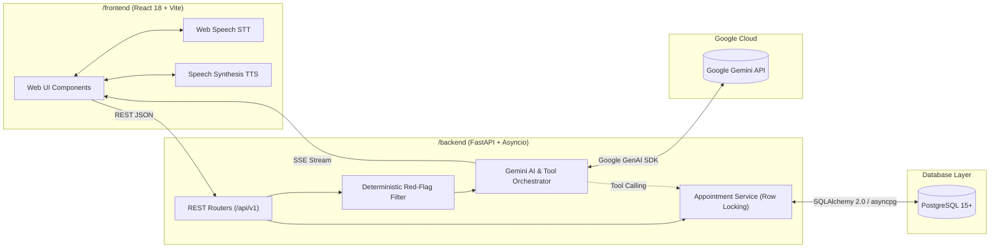

# Medicall - AI-Powered Voice Healthcare Assistant & Appointment Management

Medicall is an AI-powered, voice-enabled healthcare assistance and doctor appointment management platform. It bridges the communication gap between patients and healthcare providers by combining conversational AI, native browser speech processing, clinical safety guardrails, and real-time appointment scheduling.

> **Current Project Status:** *Architectural Design & Documentation Phase.*  
> All system specifications, database schemas, API contracts, safety protocols, and implementation plans have been independently designed and documented. Application code development will begin upon user approval.

---

## 1. Project Overview & Problem Statement

Accessing clinical care often involves cumbersome phone queues, rigid web forms, and confusion regarding which medical specialty corresponds to specific symptoms. Furthermore, elderly or visually impaired individuals face significant accessibility hurdles with complex digital portals.

**Medicall resolves these challenges through:**
- **Voice-First Interaction:** Hands-free symptom description and appointment scheduling via native browser Speech-to-Text and Text-to-Speech.
- **Dual-Tier Clinical Safety:** Immediate, deterministic red-flag emergency screening paired with non-diagnostic Google Gemini conversational triage.
- **Seamless Scheduling:** Real-time doctor directory search and calendar slot reservation protected by database-level concurrency locks.

---

## 2. Main Features

### 2.1 Core Features (Phase 1 / MVP)
- **Voice-Driven Conversational Assistant:** Browser-native speech recognition (STT) and voice feedback (TTS) using the W3C Web Speech API.
- **Multi-Layer Medical Safety Guardrails:** Deterministic keyword and regex interceptor for acute emergencies, coupled with country-configurable emergency hotlines (e.g., 911, 112, 999).
- **AI Health Navigation:** Conversational symptom clarification and medical specialty recommendations powered by Google Gemini API.
- **Doctor Directory & Search:** Filter verified practitioners by specialty, consultation fee, and available dates.
- **Interactive Appointment Booking:** Calendar-based and voice-assisted slot booking, cancellation, and rescheduling with concurrency collision protection.
- **Role-Based Access Control (RBAC):** Cryptographically secured JWT authentication with segregated domain profiles for `Patients` and `Doctors`.
- **Informed Patient Consent:** Mandatory clinical scope disclosure and zero-storage audio privacy guarantees.

### 2.2 Proposed Enhancements (Phase 2 Roadmap)
- AI Clinical Consultation Summaries for doctor pre-consultation review.
- Multi-language voice and dialect translation.
- Automated SMS and email appointment reminders.
- Integrated WebRTC telehealth video consultations.
- EHR / FHIR interoperability.

---

## 3. Technology Stack

Medicall is structured as an independent monorepo with strict isolation between client and server:

| Layer | Technology | Primary Purpose |
| :--- | :--- | :--- |
| **Frontend** | React.js (v18+) + Vite | Responsive, accessible Single Page Application |
| **Backend** | Python 3.11+ + FastAPI + Uvicorn | High-concurrency asynchronous RESTful API |
| **Database** | PostgreSQL 15+ | Relational data persistence with ACID guarantees |
| **ORM & Migrations**| SQLAlchemy 2.0 (asyncpg) + Alembic | Asynchronous data modeling and versioned migrations |
| **AI Engine** | Google Gemini API | Natural language triage & structured function calling |
| **Speech-to-Text** | Web Speech API (`SpeechRecognition`) | Zero-latency, client-side real-time voice input |
| **Text-to-Speech** | Speech Synthesis API (`SpeechSynthesis`)| Browser-native voice feedback with rate controls |
| **Streaming** | Server-Sent Events (SSE) | Real-time token streaming for AI conversations |

*Strict Architectural Rule: Medicall explicitly avoids OpenAI, ChatGPT, or GPT SDKs, standardizing on Google Gemini.*

---

## 4. Architecture Overview

---

## 5. Complete Technical Documentation Index

All technical specifications are organized within the [`docs/`](file:///Users/xoarooon/medicall/docs) directory:

| Document | Description |
| :--- | :--- |
| **[requirements.md](file:///Users/xoarooon/medicall/docs/requirements.md)** | Baseline system requirements, functional/non-functional criteria, and medical scope. |
| **[technology-stack.md](file:///Users/xoarooon/medicall/docs/technology-stack.md)** | Detailed technology justifications, versions, dependencies, and integration matrix. |
| **[architecture.md](file:///Users/xoarooon/medicall/docs/architecture.md)** | Complete system architecture, component topologies, and patient interaction workflows. |
| **[database-schema.md](file:///Users/xoarooon/medicall/docs/database-schema.md)** | Relational schema definitions, ER diagrams, PostgreSQL enums, and concurrency locking. |
| **[api-documentation.md](file:///Users/xoarooon/medicall/docs/api-documentation.md)** | Proposed REST API endpoints, schemas, status codes, and SSE streaming specifications. |
| **[ai-and-voice-workflow.md](file:///Users/xoarooon/medicall/docs/ai-and-voice-workflow.md)**| End-to-end voice and AI state machine, Gemini prompts, and tool calling protocols. |
| **[security-and-privacy.md](file:///Users/xoarooon/medicall/docs/security-and-privacy.md)**| JWT auth, RBAC matrix, IDOR prevention, informed consent, and data retention policies. |
| **[testing-strategy.md](file:///Users/xoarooon/medicall/docs/testing-strategy.md)** | Multi-tier QA plan covering unit, API, concurrent race condition, and E2E Playwright tests. |
| **[development-roadmap.md](file:///Users/xoarooon/medicall/docs/development-roadmap.md)**| Eight-phase implementation plan with detailed tasks, dependencies, and exit criteria. |
| **[deployment-guide.md](file:///Users/xoarooon/medicall/docs/deployment-guide.md)** | Production hosting topology, Docker containerization, backups, and security hardening. |
| **[architecture-decisions.md](file:///Users/xoarooon/medicall/docs/architecture-decisions.md)**| Formal Architecture Decision Records (ADR-001 through ADR-010). |

---

## 6. Planned Development Phases

1. **Phase 1: Project Setup and Architecture** - Monorepo structure, tooling, and base configuration.
2. **Phase 2: Database Development** - SQLAlchemy models, Alembic migrations, and seeding.
3. **Phase 3: Backend Development** - REST APIs, JWT authentication, and concurrency-safe booking logic.
4. **Phase 4: Frontend Development** - React component library, routing, and booking user interfaces.
5. **Phase 5: Speech Recognition (STT)** - Browser-native Web Speech STT integration and mic visualizers.
6. **Phase 6: Gemini AI Integration** - Google Gemini API integration, tool calling, and SSE streaming.
7. **Phase 7: Text-to-Speech (TTS)** - Browser-native Speech Synthesis voice feedback and clinical controls.
8. **Phase 8: Complete Integration, Testing & Deployment** - Automated concurrency testing, E2E validation, and cloud deployment.

---

## 7. Development Guidelines

- **No Premature Implementation:** Application code is strictly paused until architectural review and documentation sign-off is complete.
- **Separation of Concerns:** Keep `/frontend` and `/backend` strictly isolated with independent dependencies.
- **Zero Raw Voice Storage:** Maintain the zero-audio-storage privacy guarantee by keeping all speech processing inside the browser.
- **Safety First:** Never remove or weaken deterministic emergency triage filters.

