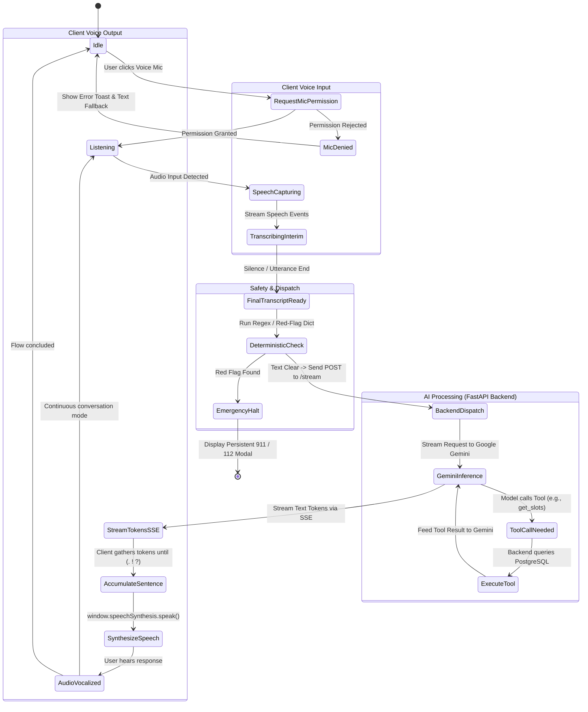
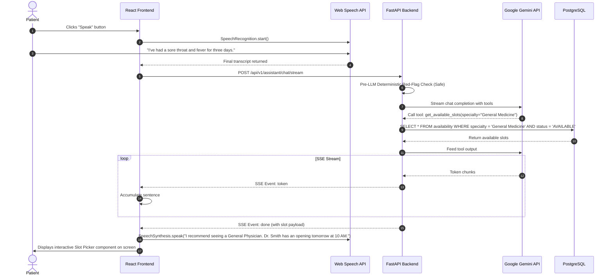

# Medicall - AI and Voice Interaction Workflow

**Project Name:** Medicall  
**Document Version:** 1.0.0  
**Status:** AI & Speech Interaction Specification  
**AI Platform:** Google Gemini API (Configurable via `GEMINI_MODEL`)  
**Speech Services:** Browser Web Speech API (`SpeechRecognition` & `SpeechSynthesis`)  
**Last Updated:** November 2026  

---

## 1. Architectural Philosophy & Safety Boundaries

Medicall blends browser-native voice capabilities with cloud-based natural language understanding to provide an intuitive, accessible clinical triage experience. 

### Core Architectural Rules:
1. **Zero Direct Database Access for AI:** Google Gemini **never** connects directly to PostgreSQL. All data querying, slot evaluation, and appointment booking must occur through backend service functions explicitly called by the backend on behalf of the AI.
2. **Deterministic Safety Before Generative AI:** Generative models are inherently non-deterministic. Acute life-threatening symptoms must be caught by deterministic, rule-based algorithms before or in parallel with model execution.
3. **Non-Diagnostic Scope:** Medicall does not provide medical diagnoses, prescription dosages, or emergency medical treatment. It strictly functions as a clinical scheduling assistant and informational symptom navigator.

---

## 2. Voice Interaction State Machine



---

## 3. Client-Side Voice Processing (Web Speech API)

### 3.1 Microphone Permissions & Hardware Capture
- The frontend requests hardware permission via `navigator.mediaDevices.getUserMedia({ audio: true })` or directly through `SpeechRecognition.start()`.
- If permission is denied (`NotAllowedError`), the application transitions gracefully to text input mode with an explanatory notification.

### 3.2 Speech Recognition (STT) Configuration
```javascript
// Reference Client Implementation Pattern
const SpeechRecognition = window.SpeechRecognition || window.webkitSpeechRecognition;
const recognition = new SpeechRecognition();

recognition.continuous = false; // Capture discrete conversational turn
recognition.interimResults = true; // Display words as the user speaks
recognition.lang = 'en-US'; // Default language (configurable)
recognition.maxAlternatives = 1;

recognition.onresult = (event) => {
  let interimTranscript = '';
  for (let i = event.resultIndex; i < event.results.length; ++i) {
    if (event.results[i].isFinal) {
      handleFinalTranscript(event.results[i][0].transcript);
    } else {
      interimTranscript += event.results[i][0].transcript;
      updateVisualTranscription(interimTranscript);
    }
  }
};
```

### 3.3 Text-to-Speech (TTS) Synthesis
```javascript
// Reference Client Speech Synthesis Pattern
const speakText = (text, onComplete) => {
  if (!window.speechSynthesis) return;
  
  window.speechSynthesis.cancel(); // Abort previous speech if active
  const utterance = new SpeechSynthesisUtterance(text);
  
  utterance.rate = 1.0; // Clear, measured clinical pace
  utterance.pitch = 1.0;
  
  // Select preferred natural English voice
  const voices = window.speechSynthesis.getVoices();
  const naturalVoice = voices.find(v => v.lang.startsWith('en') && v.name.includes('Natural')) || voices[0];
  if (naturalVoice) utterance.voice = naturalVoice;

  utterance.onend = () => {
    if (onComplete) onComplete();
  };

  window.speechSynthesis.speak(utterance);
};
```

---

## 4. Multi-Layer Medical Safety Pipeline

### 4.1 Layer 1: Deterministic Red-Flag Interceptor
Before invoking Gemini, both the React client and the FastAPI backend evaluate the user transcript against an emergency keyword and regular expression dictionary.

#### Critical Emergency Patterns:
- **Cardiovascular:** `chest pain`, `pressure in chest`, `radiating pain left arm`, `heart attack`.
- **Neurological (Stroke / F.A.S.T.):** `facial droop`, `slurred speech`, `arm weakness`, `sudden numbness`, `cannot speak`.
- **Respiratory:** `cannot breathe`, `gasping for air`, `severe shortness of breath`, `choking`.
- **Trauma & Hemorrhage:** `uncontrolled bleeding`, `coughing blood`, `vomiting blood`, `severe head injury`, `unconscious`.
- **Allergic & Poisoning:** `throat closing up`, `anaphylaxis`, `drank poison`, `drug overdose`.
- **Psychiatric Emergency:** `want to end my life`, `suicide`, `kill myself`.

If any pattern matches, the system halts immediately without invoking the LLM, emitting an `emergency` event containing the configured regional hotline (`EMERGENCY_PHONE_NUMBER`).

---

## 5. Google Gemini AI Engine & Prompt Architecture

### 5.1 System Prompt Specification
The backend initializes the Gemini model session with the following clinical system instructions:

```text
You are Medicall, an AI-powered healthcare assistant and doctor appointment coordinator.
Your objective is to help patients understand general health concerns, clarify their symptoms conversationally, recommend appropriate medical specialties, and guide them in booking appointments with registered healthcare providers.

STRICT CLINICAL SAFETY RULES:
1. You are NOT a medical doctor. You CANNOT diagnose conditions, confirm diseases, or prescribe drug dosages.
2. ALWAYS include the statement: "This information is for guidance only and does not replace clinical evaluation."
3. If the user mentions any emergency symptoms (e.g., severe chest pain, stroke symptoms, severe breathing difficulties), immediately advise them to contact emergency services and use the emergency protocol.
4. Keep answers concise, empathetic, and formatted in clear conversational sentences suitable for speech synthesis.
5. When symptom evaluation indicates that a specialist is needed, suggest the relevant specialty (e.g., Cardiology, Dermatology, Orthopedics) and use the get_available_slots tool to find open consultation times.
```

### 5.2 Intent Recognition & Entity Extraction
Gemini classifies patient inputs into primary intent categories:
1. `GREETING`: Welcome user and explain system capabilities.
2. `DESCRIBE_SYMPTOMS`: Analyze symptoms, ask clarifying questions (duration, severity), and recommend a medical specialty.
3. `SEARCH_DOCTORS`: User explicitly asks for doctors by specialty or name.
4. `CHECK_AVAILABILITY`: User requests available dates or times for an appointment.
5. `CONFIRM_BOOKING`: User selects a specific slot to finalize booking.
6. `RESCHEDULE_OR_CANCEL`: User manages an existing scheduled appointment.

---

## 6. Gemini Function / Tool Calling Architecture

Gemini does not touch PostgreSQL directly. Instead, the backend provides tool schemas to Gemini. When Gemini decides to call a tool, it outputs a structured function call request to the FastAPI backend, which executes the query securely.

### 6.1 Tool Declarations Provided to Gemini

```json
[
  {
    "name": "get_available_slots",
    "description": "Retrieves open doctor consultation slots from the database filtered by medical specialty and date.",
    "parameters": {
      "type": "OBJECT",
      "properties": {
        "specialty": {
          "type": "STRING",
          "description": "The medical specialty required, e.g., 'Cardiology', 'Dermatology', 'General Medicine'"
        },
        "target_date": {
          "type": "STRING",
          "description": "The preferred date in YYYY-MM-DD format, or 'today' / 'tomorrow'"
        }
      },
      "required": ["specialty"]
    }
  },
  {
    "name": "book_appointment_slot",
    "description": "Initiates reservation of a specific slot ID for the authenticated patient.",
    "parameters": {
      "type": "OBJECT",
      "properties": {
        "slot_id": {
          "type": "STRING",
          "description": "The unique UUID of the availability slot to reserve."
        },
        "chief_complaint": {
          "type": "STRING",
          "description": "A concise summary of the patient's symptoms."
        }
      },
      "required": ["slot_id", "chief_complaint"]
    }
  }
]
```

---

## 7. End-to-End Conversational Execution Flow



---

## 8. Voice Interaction Error Handling

| Error Scenario | Root Cause | System Response & Graceful Recovery |
| :--- | :--- | :--- |
| **Microphone Blocked** | Browser permissions denied | Display modal: *"Microphone access denied. You can continue by typing in the chat below."* Enable text input. |
| **Speech Unintelligible** | Background noise / mumbling | Voice output: *"I didn't quite catch that. Could you please repeat your symptoms or type them in the box?"* |
| **Gemini API Timeout** | External Google Cloud latency | Fall back to rule-based specialty directory lookup and present standard calendar slot picker UI. |
| **Critical Red Flag Detected**| Patient speaks emergency symptoms | Immediate visual overlay + audible alert: *"Urgent symptom detected. Please call 911 or visit the nearest ER immediately."* Halt appointment booking. |

---

## 9. Implemented Gemini AI Foundation Architecture

### 9.1 Module Layout & Separation of Concerns
The backend AI module is housed in `backend/app/ai/` with clear architectural boundaries:

```text
backend/app/ai/
├── __init__.py                     # Unified exports & backward-compatibility aliases
├── router.py                       # FastAPI routes: POST /api/v1/ai/chat, GET /api/v1/ai/status
├── schemas.py                      # Pydantic validation schemas (AIChatRequest, AIChatResponse)
├── services/
│   ├── __init__.py                 # Services bundle
│   ├── gemini_service.py           # Google GenAI SDK client, bounded retries & fallback engine
│   └── safety_service.py           # Deterministic red-flag triage & clinical output guardrails
└── prompts/
    ├── __init__.py                 # Prompt definitions export
    └── healthcare_assistant.py     # System instructions, clinical guardrails & prompt templates
```

### 9.2 Gemini SDK & Model Selection
- **Official SDK:** `google-genai` (v3.1.0)
- **Primary Model:** `gemini-3.5-flash`
  - *Diagnosis of Prior Failures:*
    - `gemini-2.5-flash`: Deprecated for new users by Google (returned HTTP 404 NOT_FOUND).
    - `gemini-3.8-flash`: Experiencing severe capacity saturation (returned HTTP 503 UNAVAILABLE).
    - `gemini-3.5-flash`: Confirmed active, healthy, and responsive with low latency.
- **Fallback Model:** `gemini-3.5-flash-lite`

### 9.3 Environment Variables
Configured in `backend/.env` (and documented in `backend/.env.example`):
```env
# Gemini AI Configuration
GEMINI_API_KEY=your_actual_gemini_api_key_here
GEMINI_MODEL=gemini-3.5-flash
GEMINI_FALLBACK_MODEL=gemini-3.5-flash-lite
GEMINI_MAX_RETRIES=3
GEMINI_TIMEOUT_SECONDS=20.0
```

### 9.4 Error Handling & Resilience
- **Transient Provider Errors (503 / 429):** Bounded exponential backoff with jitter:
  $$\text{delay} = 2^{\text{attempt}} + \text{jitter}$$
- **Fallback Model Switching:** If the primary model exhausts retry budgets on 503, `GeminiService` switches seamlessly to `gemini-3.5-flash-lite`.
- **Secret Sanitization:** Internal exceptions (e.g. invalid keys, network timeouts) are caught and logged with error codes only. User-facing responses return clean HTTP errors (503, 500, 504) without exposing credentials or internal stack traces.

### 9.5 First AI API Endpoint: `POST /api/v1/ai/chat`
* **Authentication:** Required (`Authorization: Bearer <JWT>`)
* **Request Payload (`AIChatRequest`):**
  ```json
  {
    "message": "I have had a mild dry cough for two days without fever. What should I ask my doctor?",
    "conversation_history": [
      {
        "role": "user",
        "content": "Hello"
      },
      {
        "role": "assistant",
        "content": "Hello! How can I assist you with your health inquiry today?"
      }
    ]
  }
  ```
* **Response Payload (`AIChatResponse`):**
  ```json
  {
    "response": "Hello! While a mild dry cough without fever is commonly triggered by environmental irritants or mild viral infections...",
    "urgency_level": "ROUTINE",
    "is_emergency": false,
    "emergency_guidance": null,
    "disclaimer": "Medicall AI is an informational triage and healthcare coordination assistant, not a diagnostic or prescriptive medical device...",
    "metadata": {
      "model": "gemini-3.5-flash",
      "tokens_used": 953,
      "latency_ms": 1250.4,
      "is_emergency": false,
      "matched_red_flags": null
    },
    "success": true,
    "error_message": null
  }
  ```

### 9.6 Healthcare Safety Guardrails
1. **Deterministic Red-Flag Detection:** Runs regex scanning across cardiac, stroke, respiratory, hemorrhage, consciousness, and anaphylaxis categories before dispatching to the LLM.
2. **Immediate Emergency Escalation:** If detected, returns immediate advice to call emergency services (e.g. `911`), returning `is_emergency=true` with model designated as `deterministic-safety-guardrail`.
3. **Non-Diagnostic Scope:** AI responses are post-processed to verify non-prescriptive, non-diagnostic boundaries.

### 9.7 Automated Testing Strategy
Automated tests mock external Gemini responses to guarantee isolated, zero-cost, deterministic execution in CI:
```bash
# Run complete test suite (all 86 backend tests)
PYTHONPATH=backend backend/venv/bin/pytest backend/tests -v
```
Test coverage spans authentication, empty/oversized message validation, red-flag triage, mocked success, provider 503 retry exhaustion, invalid keys, invalid models, and timeouts.

---

## 10. Phase 2: Gemini Function Calling, Database Integration & Security Hardening

### 10.1 Architecture & Module Layout
In Phase 2, the dedicated `backend/app/ai/tools/` package was introduced to mediate all interactions between Gemini and backend domain services:

```text
backend/app/ai/tools/
├── __init__.py                 # Clean package exports
├── declarations.py             # OpenAPI/Gemini FunctionDeclarations for all 6 tools
├── confirmation.py             # Cryptographically signed, short-lived JWT confirmation token logic
├── dispatcher.py               # Central execution dispatcher with Session & User context injection
├── doctor_tools.py             # execute_search_doctors, execute_get_doctor_availability
└── appointment_tools.py        # execute_get_my_appointments, execute_book_appointment,
                                # execute_cancel_appointment, execute_reschedule_appointment
```

### 10.2 Strict Data Isolation & Zero Direct Database Access
* **No Direct DB Access:** Gemini has zero access to database credentials or SQL query capabilities. All queries and mutations occur via existing `DoctorService`, `AvailabilityService`, and `AppointmentService`.
* **Patient Identity Derived from JWT:** The authenticated patient ID is strictly derived from the verified JWT `current_user` dependency. Tools reject external attempts to specify or spoof `patient_id`.
* **Clinic Timezone Standard:** Local appointment times presented to users are normalized to `Asia/Kolkata` (IST), while all database storage remains normalized UTC.

### 10.3 Explicit Patient Confirmation Protocol (Two-Stage Execution)
Write operations (`book_appointment`, `cancel_appointment`, `reschedule_appointment`) follow an atomic, cryptographically secured two-stage confirmation protocol:
1. **Stage 1 (Proposal):**
   - When called without `confirmation_token`, the tool validates that the target doctor, appointment, or slot exists and is valid.
   - It issues a short-lived (10-minute) signed JWT token encoding the patient ID, action type, and validated parameter hashes.
   - It returns `requires_confirmation: True`, the `confirmation_token`, and a human-readable summary.
   - **No database mutation is committed.**
2. **Stage 2 (Execution):**
   - Gemini presents the proposal to the patient and requests explicit confirmation.
   - When confirmed, the tool is called again with the `confirmation_token`.
   - The token signature, expiry, action scope, and authenticated patient ownership are verified.
   - The transactional backend service is executed and committed under database row-level locking.

### 10.4 Emergency Triage & Security Hardening
* **Unified National Emergency Number:** Configured to default to `112` for India deployment (`EMERGENCY_PHONE_NUMBER=112`, `DEFAULT_COUNTRY_CODE=IN`), dynamically configurable via environment settings.
* **Deterministic Negation & Historical Context Handling:** The `SafetyService` analyzes preceding and following syntactic clauses to eliminate false alarms on negated phrases (e.g. *"I do not have chest pain"*, *"denies shortness of breath"*) and historical conditions (e.g. *"had chest pain 3 years ago and had a stent"*), while reliably detecting acute recurrence or active emergency symptoms.
* **Production JWT Hardening:** In production mode (`ENVIRONMENT=production`), `Settings` startup validation rejects insecure development default secrets and mandates a secret key length of at least 32 characters.

---

## 11. Phase 2.1: Security Audit, Confirmation Hardening & Clinical Safety Validation

Phase 2.1 introduces hardened defenses against replay attacks, multi-turn AI tool auto-execution, and clinical misclassification of diagnostic inquiries.

### 11.1 Persistent Single-Use Nonce Tracking for Confirmation Tokens
- **Vulnerability Addressed:** In Phase 2, confirmation tokens were cryptographically signed JWTs with expiration timestamps. However, because they lacked persistent consumed-state tracking, a valid token could theoretically be replayed within its 10-minute window across multi-worker environments or application restarts.
- **Implementation:**
  - Every confirmation token carries a cryptographically unique `jti` (UUID4).
  - PostgreSQL table `consumed_confirmation_tokens` stores `jti`, `action`, `patient_id`, and `consumed_at` with a unique index on `jti`.
  - When a write tool (`book_appointment`, `cancel_appointment`, `reschedule_appointment`) verifies a token, it queries and flushes the token `jti` into `consumed_confirmation_tokens` within the active transaction before any appointment mutation occurs.
  - Concurrent replay attempts with the same token trigger an immediate `ConfirmationError: "This confirmation token has already been used and cannot be replayed."`

### 11.2 Gemini Orchestration Loop Guard
- **Vulnerability Addressed:** When Gemini calls a write tool without a confirmation token, the tool returns an action proposal with `requires_confirmation: True`. In a generic multi-turn function calling loop, if the tool definitions remain enabled, the model could autonomously invoke the tool again in the same turn without waiting for user consent.
- **Implementation:**
  - `GeminiService._execute_chat_with_tools` inspects every tool execution response.
  - If any tool returns `requires_confirmation: True`, the service immediately:
    1. Appends the tool proposal response to the conversation turns.
    2. Sends a final prompt with `tools=None` instructing Gemini to present the proposal to the patient conversationally.
    3. Breaks the execution loop immediately (`break`), returning the pending proposal payload in the API response.
  - No subsequent tool calls can be made within that request cycle.

### 11.3 Clinical Emergency Triage & Negation Boundary Hardening
- **Correction of "Rule Out" Hazard:** In medical parlance, phrases like *"My doctor wants to rule out a stroke"* signify active clinical suspicion and diagnostic evaluation of life-threatening events. Phase 2 previously classified "rule out" as a negation prefix. Phase 2.1 completely removes "rule out" / "ruled out" from negation lists, ensuring acute presentations trigger immediate emergency escalation.
- **Recurrence vs. Resolved Symptoms:** Refined sentence boundary parsing to differentiate between resolved historical symptoms (*"I had chest pain three years ago, but I am fine today"*) and acute recurrent presentations (*"I had chest pain last night and it is back again"*).
- **Mandatory Clinical Benchmark Validation:** Verified against 12 core clinical phrases:
  1. *"I have severe chest pain right now."* → Emergency: Acute Coronary Syndrome
  2. *"I do not have chest pain."* → Safe (Negated)
  3. *"I had chest pain three years ago, but I am fine today."* → Safe (Historical resolved)
  4. *"I had chest pain last night and it is back again."* → Emergency: Acute Coronary Syndrome (Active recurrence)
  5. *"My doctor wants to rule out a stroke."* → Emergency: Acute Cerebrovascular Event (Stroke)
  6. *"I have no difficulty breathing."* → Safe (Negated)
  7. *"I am struggling to breathe right now."* → Emergency: Severe Respiratory Compromise
  8. *"My father is unconscious."* → Emergency: Altered Level of Consciousness
  9. *"I had an allergic reaction and my throat is swelling."* → Emergency: Acute Anaphylaxis
  10. *"I have a history of bleeding, but it stopped."* → Safe (Historical resolved)
  11. *"The bleeding has started again."* → Emergency: Severe Hemorrhage
  12. *"I am thinking about hurting myself."* → Emergency: Crisis / Self-Harm Risk
- **Non-Committal Emergency Directives:** Directs patients to call emergency numbers (`112` / `911`) and explicitly discloses that Medicall cannot dispatch ambulances or emergency responders.

### 11.4 Production Security Validation & Startup Hooks
- FastAPI lifespan startup hook executes `settings.validate_production_security()` upon startup.
- In `ENVIRONMENT=production`, the application raises `RuntimeError` immediately if `JWT_SECRET_KEY` is a default, insecure, or less than 32 characters in length.

---

## 12. Phase 3: AI Voice Assistant & Frontend Integration

Phase 3 introduces the patient-facing voice assistant inside the React application, connecting browser Web Speech APIs with the FastAPI + Google Gemini backend.

### 12.1 Frontend Component Architecture
The voice assistant is modularized under `frontend/src/components/ai/` and `frontend/src/hooks/`:
- `VoiceAssistant.jsx`: Master orchestrator coordinating speech recognition, synthesis, message flow, confirmation cards, and fallback inputs.
- `MicrophoneButton.jsx`: Multi-state animated circular microphone button (`idle`, `listening`, `processing`, `speaking`, `error`, `unsupported`).
- `ConversationPanel.jsx`: Scrollable message container with auto-scroll preservation, interim speech bubbles, and suggestion chips.
- `MessageBubble.jsx`: Differentiates patient (forest green) and assistant (warm ivory) turns with timestamps, TTS replay, and clinical disclaimers.
- `ConfirmationCard.jsx`: Interactive appointment confirmation card for booking, cancellation, and rescheduling proposals with explicit single-use confirmation buttons.
- `VoiceControls.jsx`: Audio controls for muting, stopping playback, replaying responses, and speed regulation (0.9x, 1.0x, 1.2x).
- `AssistantStatus.jsx`: Real-time state indicator displaying connection, active Google Gemini model, and JWT security status.
- `EmergencyBanner.jsx`: High-visibility red alert banner with one-click emergency dialing (`tel:112`) and ambulance non-dispatch disclaimers.

### 12.2 Speech Recognition (`useSpeechRecognition`)
- **Technology:** Browser Web Speech API (`SpeechRecognition` / `webkitSpeechRecognition`).
- **Activation:** Explicit patient activation only; zero background recording.
- **Language:** Initialized to `en-IN` (English - India) with dynamic configuration.
- **Transcript Streaming:** Streams interim hypotheses in real time while patient is speaking.
- **Deduplication:** Prevents duplicate submissions of identical final transcripts to the backend.
- **Resilience:** Gracefully maps `not-allowed`, `no-speech`, `audio-capture`, `network`, and browser unsupported states.

### 12.3 Speech Synthesis (`useSpeechSynthesis`)
- **Technology:** Browser SpeechSynthesis API (`window.speechSynthesis`).
- **Safety & Filtering:** Cleans assistant text before vocalization, stripping markdown bold/heading tags, URLs, and bullet points to generate natural speech.
- **Boundary:** Only vocalizes assistant responses; patient messages and long prior history are never spoken aloud.
- **Controls:** Allows instant stop, replay, mute toggle (persisted in `localStorage`), and speed adjustment.

### 12.4 Full-Stack Appointment Confirmation Protocol
1. **Proposal Generation:** The user speaks or types an intent (e.g., *"Book an appointment with Dr. Sarah tomorrow at 10 AM"*). Gemini calls `book_appointment` without a token, returning an action proposal with a signed single-use JWT.
2. **Deterministic UI Card:** The frontend displays `<ConfirmationCard />` with structured doctor, date, time, and fee details.
3. **Explicit Patient Authorization:** The patient presses "Confirm Booking" (or "Confirm Cancellation" / "Confirm Reschedule").
4. **Dedicated Backend Execution:** The frontend invokes `POST /api/v1/ai/confirm`, where the backend validates the token, patient identity, and single-use nonce (`jti`), executing the booking under PostgreSQL row-level locks.


