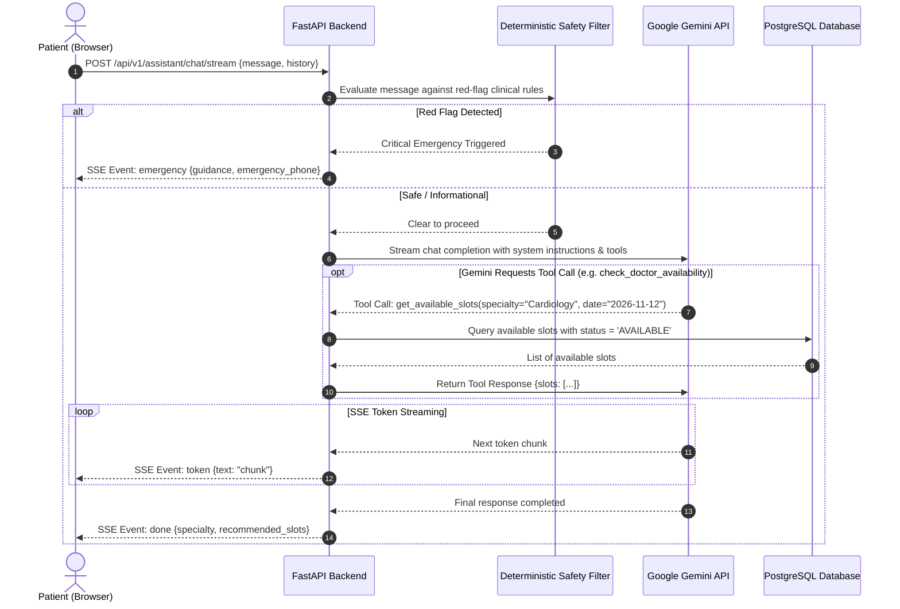
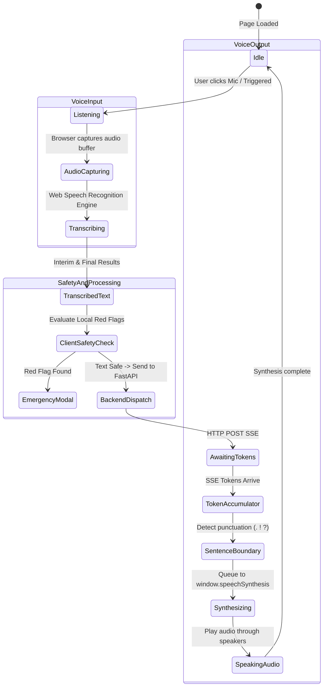
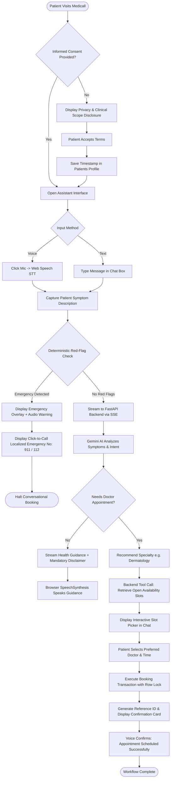

# Medicall - System Architecture Specification

**Project Name:** Medicall  
**Document Version:** 1.0.0  
**Status:** Architecture Specification  
**Last Updated:** November 2026  

---

## 1. High-Level System Architecture

Medicall is designed as a modular, decoupled web system contained within a monorepo structure. The system strictly separates client presentation from server-side domain logic, data persistence, and external artificial intelligence orchestration.

### 1.1 Architectural Blueprint

```mermaid
flowchart TD
    subgraph ClientLayer["Frontend Application (Browser / Client)"]
        UI["React.js SPA (Vite)"]
        STT["Web Speech API (Speech-to-Text)"]
        TTS["Speech Synthesis API (Text-to-Speech)"]
        SSEClient["SSE Stream Reader (EventSource / Fetch)"]
        UI <--> STT
        UI <--> TTS
        UI <--> SSEClient
    end

    subgraph Network["Network Boundaries (HTTPS / TLS 1.3)"]
        REST_REQ["REST API Requests (JSON)"]
        SSE_STREAM["Server-Sent Events (text/event-stream)"]
    end

    subgraph BackendLayer["Backend Application (FastAPI Asynchronous Engine)"]
        Router["FastAPI API Routers (/api/v1)"]
        Safety["Deterministic Red-Flag Interceptor (Pre-LLM)"]
        AuthMiddleware["JWT Authentication & RBAC Middleware"]
        ApptService["Appointment & Schedule Service"]
        GeminiService["Gemini AI Orchestrator & Tool Handler"]

        Router --> AuthMiddleware
        Router --> Safety
        Safety --> GeminiService
        Router --> ApptService
        GeminiService -. Function Calls .-> ApptService
    end

    subgraph DataStorage["Persistence Layer (ACID Relational Datastore)"]
        Postgres[("PostgreSQL 15+ Database")]
        ApptService <-->|SQLAlchemy 2.0 Async / asyncpg| Postgres
    end

    subgraph ExternalAI["External AI Services (Google Cloud)"]
        GeminiAPI["Google Gemini API (Configurable Model)"]
        GeminiService <-->|Google GenAI SDK (HTTPS)| GeminiAPI
    end

    UI --> REST_REQ --> Router
    GeminiService --> SSE_STREAM --> SSEClient
```

---

## 2. Frontend Application Architecture (`/frontend`)

The frontend is an independent Single Page Application (SPA) built using React 18 and Vite. It is strictly organized into clean architectural layers:

```
frontend/src/
├── assets/             # Global static assets (SVGs, medical iconography)
├── components/         # Reusable UI component library
│   ├── common/         # Layout wrappers, buttons, modals, emergency banners
│   ├── voice/          # Microphone button, waveform visualizer, audio controls
│   ├── appointments/   # Calendar slot grid, appointment cards, status badges
│   └── doctor/         # Doctor cards, specialty tags, fee displays
├── context/            # React Context providers for global state
│   ├── AuthContext.jsx # User identity, JWT tokens, active role state
│   └── VoiceContext.jsx# STT/TTS settings, listening state, audio synthesis queue
├── hooks/              # Custom encapsulated React hooks
│   ├── useSpeechToText.js    # Browser SpeechRecognition lifecycle and events
│   ├── useSpeechSynthesis.js # Browser SpeechSynthesis utterance controller
│   └── useSSEChat.js         # Server-Sent Events stream reader for AI responses
├── pages/              # Primary route pages (React Router)
│   ├── HomePage.jsx          # Public landing and feature navigation
│   ├── AssistantPage.jsx     # Core voice/text conversational triage interface
│   ├── DoctorsPage.jsx       # Doctor directory with filtering
│   ├── AppointmentsPage.jsx  # Patient booking history and rescheduling
│   ├── DoctorDashboard.jsx   # Doctor portal for schedule and queue management
│   └── LoginPage.jsx         # Authentication and registration portal
├── services/           # HTTP API client layer (Axios / Fetch)
│   ├── api.js                # Base HTTP instance with JWT interceptor
│   ├── authService.js        # Login, register, token refresh
│   ├── doctorService.js      # Doctor directory and availability retrieval
│   └── appointmentService.js # Booking, cancellation, and rescheduling
├── App.jsx             # Top-level route definition & layout boundary
└── main.jsx            # Application mount point
```

### 2.1 State & Voice Flow in Frontend
1. **Voice Input Flow:** The user activates the microphone via `VoiceMicButton`. `useSpeechToText` initializes `window.SpeechRecognition`. Interim speech events update the transcript live on screen.
2. **Deterministic Pre-Check:** Transcribed text is evaluated locally for emergency keywords before sending.
3. **Dispatch & Stream:** If clear, `useSSEChat` initiates a `POST` request to `/api/v1/assistant/chat/stream`.
4. **Voice Output Flow:** As SSE tokens arrive, complete sentences are accumulated and queued into `useSpeechSynthesis`, playing voice responses back in real-time without waiting for the full response.

---

## 3. Backend Application Architecture (`/backend`)

The backend follows an Asynchronous Layered Architecture adhering to the Single Responsibility Principle.

```
backend/app/
├── api/
│   └── v1/                   # Versioned API Routers
│       ├── auth.py           # Authentication routes (login, register, me)
│       ├── patients.py       # Patient profile, medical history, consent
│       ├── doctors.py        # Doctor directory, search, schedule configs
│       ├── appointments.py   # Booking, rescheduling, cancellation
│       ├── assistant.py      # Conversational triage & SSE streaming endpoint
│       └── router.py         # Root aggregator for /api/v1
├── core/
│   ├── config.py             # Pydantic BaseSettings (DB URL, Gemini key, CORS)
│   ├── security.py           # Password hashing (bcrypt) and JWT verification
│   └── safety.py             # Deterministic red-flag keyword dictionaries & regex
├── db/
│   ├── base.py               # Declarative Base for SQLAlchemy ORM
│   └── session.py            # Async engine and async_sessionmaker setup
├── models/                   # SQLAlchemy ORM database models
│   ├── user.py               # Base system user model
│   ├── patient.py            # Patient domain profile model
│   ├── doctor.py             # Doctor domain profile model
│   ├── schedule.py           # Recurring weekly schedule template model
│   ├── availability.py       # Specific date slot model
│   └── appointment.py        # Appointment booking model
├── schemas/                  # Pydantic v2 validation models
│   ├── user.py               # User input/output schemas
│   ├── patient.py            # Patient profile schemas
│   ├── doctor.py             # Doctor profile schemas
│   ├── schedule.py           # Schedule & availability schemas
│   ├── appointment.py        # Booking request/response schemas
│   └── assistant.py          # Conversational message & tool calling schemas
├── services/                 # Pure business logic layer
│   ├── appointment_service.py# Booking validation, slot collision protection
│   ├── doctor_service.py     # Slot generation and schedule calculation
│   ├── gemini_service.py     # Google Gemini API client, prompts, and tools
│   └── triage_service.py     # Emergency detection and clinical safety logic
└── main.py                   # FastAPI initialization, middleware, lifecycle
```

---

## 4. Database Architecture & Concurrency Strategy

Medicall relies on PostgreSQL 15+ to maintain relational integrity and enforce transactional guarantees.

### 4.1 Concurrency & Double-Booking Prevention
In high-concurrency environments, two patients might attempt to book the exact same doctor slot simultaneously. Medicall guarantees zero double-bookings through a three-tier defense:

1. **Discrete Slot Isolation:** Every bookable appointment slot corresponds to a row in the `availability` table.
2. **Database Row-Level Locking:** During the booking transaction, the backend executes:
   ```sql
   SELECT id, status FROM availability 
   WHERE id = :slot_id AND status = 'AVAILABLE' 
   FOR UPDATE;
   ```
   This locks the specific slot row until the transaction commits or rolls back, forcing concurrent requests to wait sequentially.
3. **Database Unique Constraint:** The `appointments` table enforces a `UNIQUE` constraint on `availability_id`. Even if an application bug bypassed row locking, the database engine strictly rejects a second insertion with an `IntegrityError`.

---

## 5. Gemini AI Architecture & Function Calling

The Google Gemini API is accessed strictly via the backend service layer (`GeminiService`). Gemini is never exposed directly to the public web and never connects directly to PostgreSQL.



### 5.1 Tool Calling Definitions
Gemini is provided with structured function schemas:
- `search_doctors(specialty: str, max_fee: float)`: Discovers matching doctors.
- `get_available_slots(doctor_id: str, date: str)`: Queries discrete open slots from PostgreSQL.
- `verify_patient_identity()`: Confirms patient authentication before booking.

---

## 6. Speech Processing Architecture

All voice transcription (STT) and voice synthesis (TTS) occurs entirely within the client's browser, utilizing the native W3C Web Speech API.



---

## 7. Complete Patient Interaction Workflow



---

## 8. Summary of Architectural Guarantees

1. **Decoupled Monorepo:** Frontend and backend applications can be built, tested, and containerized independently.
2. **Zero Audio Cloud Costs:** Audio processing is 100% native client-side, reducing server bandwidth and ensuring zero voice biometrics are persisted.
3. **Medical Safety Priority:** Dual-layer triage (deterministic filter + Gemini guardrails) guarantees acute emergencies are never delayed by LLM processing.
4. **Data Integrity & Concurrency:** PostgreSQL row-level locks (`SELECT FOR UPDATE`) prevent scheduling collisions under concurrent multi-user load.
5. **Two-Stage Cryptographic Confirmation:** All appointment write operations (booking, cancellation, rescheduling) require explicit, out-of-band patient confirmation backed by persistent single-use cryptographic tokens (`consumed_confirmation_tokens`).


