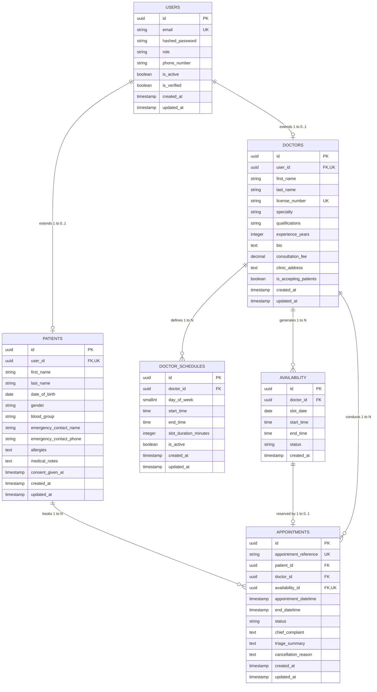

# Medicall - Relational Database Schema Specification

**Project Name:** Medicall  
**Document Version:** 1.0.0  
**Status:** Database Architecture Specification  
**Database Engine:** PostgreSQL 15+  
**ORM:** SQLAlchemy 2.0 (Async Engine via `asyncpg`)  
**Migration Tool:** Alembic  
**Last Updated:** November 2026  

---

## 1. Schema Overview & Normalization Strategy

The Medicall database is structured to achieve **Third Normal Form (3NF)** while providing high transactional throughput, data integrity, and strict isolation between authentication and domain logic.

### 1.1 Key Architectural Decisions
1. **Base User vs. Domain Profile Separation:** Authentication credentials, email, password hashes, and system roles reside exclusively in `users`. Domain-specific data for healthcare recipients resides in `patients`, while clinical credentials and practice details reside in `doctors`. Both link back to `users.id` via strict 1-to-0..1 foreign key relationships.
2. **Template Schedule vs. Discrete Slot Separation:** Recurring weekly working hours are stored in `doctor_schedules`. Concrete bookable calendar slots for specific calendar dates are generated into `availability`. This allows doctors to set general templates while supporting holiday blocks, sick days, and custom hours.
3. **Double-Booking Elimination:** The `appointments` table references `availability_id` with a database-level `UNIQUE` constraint, backed by row-level locking (`SELECT FOR UPDATE`) during booking transactions.

---

## 2. Entity-Relationship Diagram (ERD)



---

## 3. Data Dictionary & Detailed Entity Specifications

### 3.1 `users` Table
Stores core user identity, credentials, and authorization roles.

| Column | Data Type | Constraints | Description |
| :--- | :--- | :--- | :--- |
| `id` | `UUID` | `PRIMARY KEY`, Default `gen_random_uuid()` | Unique user identifier |
| `email` | `VARCHAR(255)` | `NOT NULL`, `UNIQUE`, Indexed | Unique account email address |
| `hashed_password` | `VARCHAR(255)` | `NOT NULL` | Cryptographic bcrypt password hash |
| `role` | `user_role_enum` | `NOT NULL`, Default `'PATIENT'` | Enum: `'PATIENT'`, `'DOCTOR'`, `'ADMIN'` |
| `phone_number` | `VARCHAR(32)` | `NULLABLE` | Contact telephone number |
| `is_active` | `BOOLEAN` | `NOT NULL`, Default `TRUE` | Account active status flag |
| `is_verified` | `BOOLEAN` | `NOT NULL`, Default `FALSE` | Email verification status |
| `created_at` | `TIMESTAMPTZ` | `NOT NULL`, Default `CURRENT_TIMESTAMP` | Record creation timestamp |
| `updated_at` | `TIMESTAMPTZ` | `NOT NULL`, Default `CURRENT_TIMESTAMP` | Last record update timestamp |

### 3.2 `patients` Table
Stores demographic, emergency, and clinical intake information for patients.

| Column | Data Type | Constraints | Description |
| :--- | :--- | :--- | :--- |
| `id` | `UUID` | `PRIMARY KEY`, Default `gen_random_uuid()` | Unique patient profile ID |
| `user_id` | `UUID` | `NOT NULL`, `UNIQUE`, `FK -> users(id) ON DELETE CASCADE` | Link to base authentication account |
| `first_name` | `VARCHAR(100)` | `NOT NULL` | Legal given name |
| `last_name` | `VARCHAR(100)` | `NOT NULL` | Legal family name |
| `date_of_birth` | `DATE` | `NOT NULL` | Patient birth date |
| `gender` | `VARCHAR(32)` | `NULLABLE` | Gender identity |
| `blood_group` | `VARCHAR(10)` | `NULLABLE` | ABO/Rh blood classification (e.g., O+) |
| `emergency_contact_name` | `VARCHAR(100)` | `NULLABLE` | Primary emergency contact person |
| `emergency_contact_phone`| `VARCHAR(32)` | `NULLABLE` | Primary emergency contact number |
| `allergies` | `TEXT` | `NULLABLE` | Known drug or environmental allergies |
| `medical_notes` | `TEXT` | `NULLABLE` | Baseline health profile and medical history |
| `consent_given_at` | `TIMESTAMPTZ` | `NULLABLE` | Timestamp of explicit privacy & AI consent |
| `created_at` | `TIMESTAMPTZ` | `NOT NULL`, Default `CURRENT_TIMESTAMP` | Record creation timestamp |
| `updated_at` | `TIMESTAMPTZ` | `NOT NULL`, Default `CURRENT_TIMESTAMP` | Last record update timestamp |

### 3.3 `doctors` Table
Stores medical practitioner licensing, specialties, and clinical metadata.

| Column | Data Type | Constraints | Description |
| :--- | :--- | :--- | :--- |
| `id` | `UUID` | `PRIMARY KEY`, Default `gen_random_uuid()` | Unique doctor profile ID |
| `user_id` | `UUID` | `NOT NULL`, `UNIQUE`, `FK -> users(id) ON DELETE CASCADE` | Link to base authentication account |
| `first_name` | `VARCHAR(100)` | `NOT NULL` | Doctor given name |
| `last_name` | `VARCHAR(100)` | `NOT NULL` | Doctor family name |
| `license_number` | `VARCHAR(100)` | `NOT NULL`, `UNIQUE`, Indexed | Official medical board license ID |
| `specialty` | `VARCHAR(100)` | `NOT NULL`, Indexed | Clinical specialty (e.g., Cardiology) |
| `qualifications` | `VARCHAR(255)` | `NOT NULL` | Educational degrees (e.g., MBBS, MD) |
| `experience_years` | `INTEGER` | `NOT NULL`, Default `0`, `CHECK (>= 0)` | Total years of clinical practice |
| `bio` | `TEXT` | `NULLABLE` | Professional biography and focus |
| `consultation_fee` | `NUMERIC(10, 2)`| `NOT NULL`, Default `0.00`, `CHECK (>= 0)` | Standard consultation charge |
| `clinic_address` | `TEXT` | `NULLABLE` | Physical consultation clinic address |
| `is_accepting_patients` | `BOOLEAN` | `NOT NULL`, Default `TRUE` | Whether open to new appointments |
| `created_at` | `TIMESTAMPTZ` | `NOT NULL`, Default `CURRENT_TIMESTAMP` | Record creation timestamp |
| `updated_at` | `TIMESTAMPTZ` | `NOT NULL`, Default `CURRENT_TIMESTAMP` | Last record update timestamp |

### 3.4 `doctor_schedules` Table
Stores recurring weekly working hour templates configured by doctors.

| Column | Data Type | Constraints | Description |
| :--- | :--- | :--- | :--- |
| `id` | `UUID` | `PRIMARY KEY`, Default `gen_random_uuid()` | Unique schedule template ID |
| `doctor_id` | `UUID` | `NOT NULL`, `FK -> doctors(id) ON DELETE CASCADE` | Doctor owning this schedule |
| `day_of_week` | `SMALLINT` | `NOT NULL`, `CHECK (day_of_week BETWEEN 0 AND 6)` | 0 = Monday, ..., 6 = Sunday |
| `start_time` | `TIME` | `NOT NULL` | Shift start time (e.g., 09:00:00) |
| `end_time` | `TIME` | `NOT NULL`, `CHECK (end_time > start_time)` | Shift end time (e.g., 17:00:00) |
| `slot_duration_minutes` | `INTEGER` | `NOT NULL`, Default `30`, `CHECK (> 0)` | Interval per consultation slot |
| `is_active` | `BOOLEAN` | `NOT NULL`, Default `TRUE` | Whether this weekly day is active |
| `created_at` | `TIMESTAMPTZ` | `NOT NULL`, Default `CURRENT_TIMESTAMP` | Record creation timestamp |
| `updated_at` | `TIMESTAMPTZ` | `NOT NULL`, Default `CURRENT_TIMESTAMP` | Last record update timestamp |

### 3.5 `availability` Table
Stores discrete bookable time windows and doctor availability overrides for specific dates.

| Column | Data Type | Constraints | Description |
| :--- | :--- | :--- | :--- |
| `id` | `UUID` | `PRIMARY KEY`, Default `gen_random_uuid()` | Unique availability slot ID |
| `doctor_id` | `UUID` | `NOT NULL`, `FK -> doctors(id) ON DELETE CASCADE` | Doctor offering this slot |
| `slot_date` | `DATE` | `NOT NULL`, Indexed | Calendar date of availability |
| `start_time` | `TIME` | `NOT NULL` | Slot start time |
| `end_time` | `TIME` | `NOT NULL`, `CHECK (end_time > start_time)` | Slot end time |
| `status` | `availability_status_enum` | `NOT NULL`, Default `'AVAILABLE'` | `'AVAILABLE'`, `'BOOKED'`, `'BLOCKED'` |
| `created_at` | `TIMESTAMPTZ` | `NOT NULL`, Default `CURRENT_TIMESTAMP` | Record creation timestamp |

### 3.6 `appointments` Table
Stores finalized consultation bookings between patients and healthcare providers.

| Column | Data Type | Constraints | Description |
| :--- | :--- | :--- | :--- |
| `id` | `UUID` | `PRIMARY KEY`, Default `gen_random_uuid()` | Unique appointment ID |
| `appointment_reference` | `VARCHAR(32)` | `NOT NULL`, `UNIQUE`, Indexed | Patient-facing code (e.g., MED-2611-9X) |
| `patient_id` | `UUID` | `NOT NULL`, `FK -> patients(id) ON DELETE RESTRICT` | Booking patient |
| `doctor_id` | `UUID` | `NOT NULL`, `FK -> doctors(id) ON DELETE RESTRICT` | Booked medical practitioner |
| `availability_id` | `UUID` | `NULLABLE`, `UNIQUE`, `FK -> availability(id)` | Reserved discrete availability slot |
| `appointment_datetime` | `TIMESTAMPTZ` | `NOT NULL`, Indexed | Exact starting timestamp |
| `end_datetime` | `TIMESTAMPTZ` | `NOT NULL`, `CHECK (end_datetime > appointment_datetime)` | Exact ending timestamp |
| `status` | `appointment_status_enum` | `NOT NULL`, Default `'SCHEDULED'` | Lifecycle state (see Enum) |
| `chief_complaint` | `TEXT` | `NOT NULL` | Primary reason for visit / symptoms |
| `triage_summary` | `TEXT` | `NULLABLE` | AI assistant preliminary summary |
| `cancellation_reason` | `TEXT` | `NULLABLE` | Documented reason if cancelled |
| `created_at` | `TIMESTAMPTZ` | `NOT NULL`, Default `CURRENT_TIMESTAMP` | Record creation timestamp |
| `updated_at` | `TIMESTAMPTZ` | `NOT NULL`, Default `CURRENT_TIMESTAMP` | Last record update timestamp |

---

## 4. PostgreSQL Enums

```sql
-- Role Enum for Users
CREATE TYPE user_role_enum AS ENUM (
    'PATIENT',
    'DOCTOR',
    'ADMIN'
);

-- Slot Availability Status Enum
CREATE TYPE availability_status_enum AS ENUM (
    'AVAILABLE',
    'BOOKED',
    'BLOCKED'
);

-- Appointment Lifecycle Status Enum
CREATE TYPE appointment_status_enum AS ENUM (
    'SCHEDULED',
    'COMPLETED',
    'CANCELLED_PATIENT',
    'CANCELLED_DOCTOR',
    'RESCHEDULED'
);
```

---

## 5. Indexes for Query Performance

To guarantee sub-150ms query latency under production conditions, the following indexes are defined:

```sql
-- 1. Authentication & User Lookups
CREATE INDEX idx_users_email ON users(email);
CREATE INDEX idx_users_role ON users(role);

-- 2. Doctor Directory Searches
CREATE INDEX idx_doctors_specialty ON doctors(specialty);
CREATE INDEX idx_doctors_license ON doctors(license_number);
CREATE INDEX idx_doctors_active_fee ON doctors(is_accepting_patients, consultation_fee);

-- 3. Availability Calendar Queries
CREATE INDEX idx_availability_search ON availability(doctor_id, slot_date, status);
CREATE INDEX idx_availability_date_status ON availability(slot_date, status);

-- 4. Appointment Lookups & Filter by Patient / Doctor
CREATE INDEX idx_appointments_patient ON appointments(patient_id, appointment_datetime DESC);
CREATE INDEX idx_appointments_doctor ON appointments(doctor_id, appointment_datetime DESC);
CREATE INDEX idx_appointments_ref ON appointments(appointment_reference);
CREATE INDEX idx_appointments_status ON appointments(status);
```

---

## 6. Concurrency Control & Double-Booking Prevention

To eliminate race conditions when two patients simultaneously attempt to reserve the same slot:

```sql
-- Transaction Example for Safe Appointment Reservation
BEGIN;

-- Step 1: Lock the targeted availability slot row
SELECT id, doctor_id, slot_date, start_time, end_time, status 
FROM availability 
WHERE id = '7c9e6679-7425-40de-944b-e07fc1f90ae7' 
  AND status = 'AVAILABLE'
FOR UPDATE;

-- If no row returned (already booked or locked), ROLLBACK and abort with 409 Conflict.

-- Step 2: Mark slot as BOOKED
UPDATE availability 
SET status = 'BOOKED' 
WHERE id = '7c9e6679-7425-40de-944b-e07fc1f90ae7';

-- Step 3: Insert the Appointment record
INSERT INTO appointments (
    id,
    appointment_reference,
    patient_id,
    doctor_id,
    availability_id,
    appointment_datetime,
    end_datetime,
    status,
    chief_complaint
) VALUES (
    gen_random_uuid(),
    'MED-20261110-A7X',
    'a1b2c3d4-0000-0000-0000-000000000001',
    'd1e2f3a4-0000-0000-0000-000000000002',
    '7c9e6679-7425-40de-944b-e07fc1f90ae7',
    '2026-11-15 10:00:00+00',
    '2026-11-15 10:30:00+00',
    'SCHEDULED',
    'Persistent dry cough and mild fever'
);

COMMIT;
```

If a concurrent transaction attempts to book the same slot, the `FOR UPDATE` lock forces it to wait. When the first transaction commits, the second transaction sees `status = 'BOOKED'`, causing the backend to immediately reject the duplicate request with an HTTP `409 Conflict`. Additionally, the `UNIQUE (availability_id)` constraint prevents accidental insertion at the storage layer.

---

## 7. Cryptographic Single-Use Confirmation Nonce Storage

To permanently eliminate replay attacks on action confirmation tokens across multiple worker processes, restarts, and concurrent requests:

```sql
CREATE TABLE consumed_confirmation_tokens (
    id UUID PRIMARY KEY DEFAULT gen_random_uuid(),
    jti VARCHAR(64) NOT NULL,
    action VARCHAR(64) NOT NULL,
    patient_id UUID NOT NULL REFERENCES patients(id) ON DELETE CASCADE,
    consumed_at TIMESTAMP WITH TIME ZONE NOT NULL DEFAULT CURRENT_TIMESTAMP,
    expires_at TIMESTAMP WITH TIME ZONE NULL
);

-- Unique index ensuring atomic single-use nonce consumption
CREATE UNIQUE INDEX uq_consumed_token_jti ON consumed_confirmation_tokens(jti);
CREATE INDEX idx_consumed_token_patient ON consumed_confirmation_tokens(patient_id);
```

When an appointment write action (`book_appointment`, `cancel_appointment`, `reschedule_appointment`) is verified, its `jti` is checked against and flushed into `consumed_confirmation_tokens` within the ongoing database transaction. Any attempt to replay the token triggers an immediate unique constraint violation, aborting the operation.


