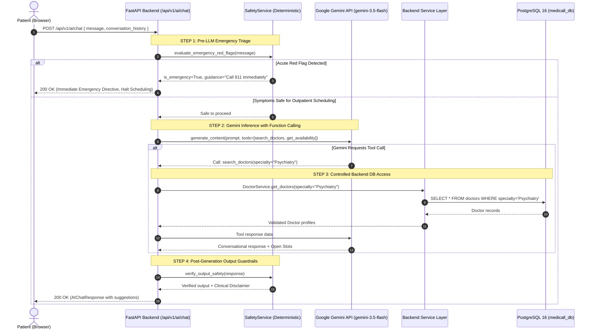
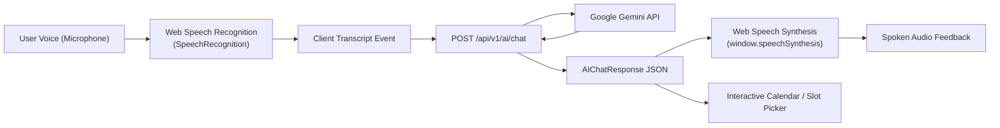

# Medicall — Google Gemini AI Integration Architecture & Function-Calling Plan

**Document Version:** 1.0.0  
**Status:** Phase 2 Architecture Specification  
**Author:** Senior AI Integration Architect & Full-Stack Lead  
**Target SDK:** `google-genai` (v3.1.0+)  
**Target Model:** `gemini-3.5-flash` (Primary) with `gemini-3.5-flash-lite` (Fallback)  

---

## 1. Core Architectural Directives

1. **Zero Direct Database Access for AI:**
   Google Gemini **must never** have direct network access or credentials to PostgreSQL. All data querying, slot checking, and appointment mutations must occur strictly through Python backend service functions executed by FastAPI.
2. **Deterministic Clinical Safety First:**
   Generative AI models are probabilistic. Acute life-threatening red flags (chest pain, stroke symptoms, respiratory failure, severe bleeding) must be intercepted by deterministic rules before or in parallel with LLM inference.
3. **Strict Human-in-the-Loop Confirmation:**
   The AI assistant may discover doctors and present open availability slots automatically. However, booking, rescheduling, or cancelling an appointment **mandates explicit patient confirmation** before committing changes to the database.
4. **Patient Data Isolation:**
   The AI must only have access to the authenticated patient's records. It cannot query or disclose records belonging to other patients.

---

## 2. Gemini Function-Calling Architecture

When a patient speaks or types an intent (e.g. *"I need to see a psychiatrist this Friday afternoon for anxiety"*), the Gemini model analyzes the utterance, determines that tools are required, and emits structured tool-call arguments. FastAPI executes the validated backend services and feeds the structured result back to Gemini for patient-facing synthesis.



---

## 3. Gemini Tool Catalog (Controlled Function Calling)

The following backend services will be registered as Gemini tool declarations in Phase 2:

### Tool 1: `search_doctors`
* **Purpose:** Queries verified healthcare specialists matching patient criteria.
* **Backend Delegate:** `DoctorService.get_doctors(db, specialty, is_accepting_patients=True)`
* **Parameters:**
  ```json
  {
    "type": "OBJECT",
    "properties": {
      "specialty": {
        "type": "STRING",
        "description": "Medical specialty (e.g. 'Psychiatry', 'Cardiology', 'General Practice')"
      },
      "max_fee": {
        "type": "NUMBER",
        "description": "Maximum consultation fee in dollars"
      }
    }
  }
  ```

### Tool 2: `get_doctor_availability`
* **Purpose:** Retrieves open, bookable consultation slots for a specific doctor within a date range.
* **Backend Delegate:** `AvailabilityService.get_availability(db, doctor_id, date_from, date_to, status='AVAILABLE')`
* **Parameters:**
  ```json
  {
    "type": "OBJECT",
    "properties": {
      "doctor_id": {
        "type": "STRING",
        "description": "UUID of the doctor"
      },
      "date_from": {
        "type": "STRING",
        "description": "Start date in YYYY-MM-DD format"
      },
      "date_to": {
        "type": "STRING",
        "description": "End date in YYYY-MM-DD format"
      }
    },
    "required": ["doctor_id", "date_from", "date_to"]
  }
  ```

### Tool 3: `book_appointment_tool`
* **Purpose:** Atomically claims an availability slot and books an appointment for the authenticated patient.
* **Backend Delegate:** `AppointmentService.book_appointment(db, current_patient, data)`
* **Guard:** Mandates `patient_confirmed=True` parameter from user before execution.
* **Parameters:**
  ```json
  {
    "type": "OBJECT",
    "properties": {
      "doctor_id": { "type": "STRING" },
      "availability_id": { "type": "STRING" },
      "chief_complaint": { "type": "STRING" },
      "patient_confirmed": { "type": "BOOLEAN", "description": "Must be TRUE only after patient explicitly states confirmation" }
    },
    "required": ["doctor_id", "availability_id", "chief_complaint", "patient_confirmed"]
  }
  ```

### Tool 4: `reschedule_appointment_tool`
* **Purpose:** Moves an existing active appointment to a new open availability slot.
* **Backend Delegate:** `AppointmentService.reschedule_appointment(db, appointment_id, new_availability_id, current_user)`
* **Guard:** Validates appointment ownership and requires explicit confirmation.

### Tool 5: `cancel_appointment_tool`
* **Purpose:** Cancels a scheduled consultation and restores the slot to `AVAILABLE`.
* **Backend Delegate:** `AppointmentService.cancel_appointment(db, appointment_id, current_user, reason)`
* **Guard:** Requires patient confirmation.

### Tool 6: `get_my_appointments`
* **Purpose:** Retrieves upcoming and past consultation records for the logged-in patient.
* **Backend Delegate:** `AppointmentService.get_patient_appointments(db, current_patient.id)`
* **Parameters:** None (Context derived securely from JWT token).

### Tool 7: `get_hospital_info`
* **Purpose:** Answers general inquiries (clinic address, operating hours, emergency procedures).
* **Backend Delegate:** Static verified clinic configuration.

---

## 4. Voice Integration Architecture (Frontend Web Speech API)



1. **Speech-to-Text (STT):** Leverages browser-native `webkitSpeechRecognition` / `SpeechRecognition` for low-latency client-side transcription without sending raw audio bytes over the network.
2. **Text-to-Speech (TTS):** Uses browser-native `window.speechSynthesis` to vocalize concise assistant answers.
3. **Visual Confirmation:** Interactive UI components (slot pills, doctor cards) accompany spoken responses on the React UI.

---

## 5. Security, Privacy & Compliance Controls

- **API Key Protection:** `GEMINI_API_KEY` resides strictly on the backend. It is never transmitted to the browser or embedded in client assets.
- **PII Scrubbing:** Patient names, addresses, and phone numbers are omitted from Gemini prompts. Only sanitized clinical symptom summaries are transmitted.
- **Audit Logging:** Every AI consultation and tool execution logs user ID, action taken, and latency without logging sensitive health text.
- **Session Bounding:** Conversation history passed to Gemini is bounded to the last 10 turns to prevent token exhaustion and context pollution.

