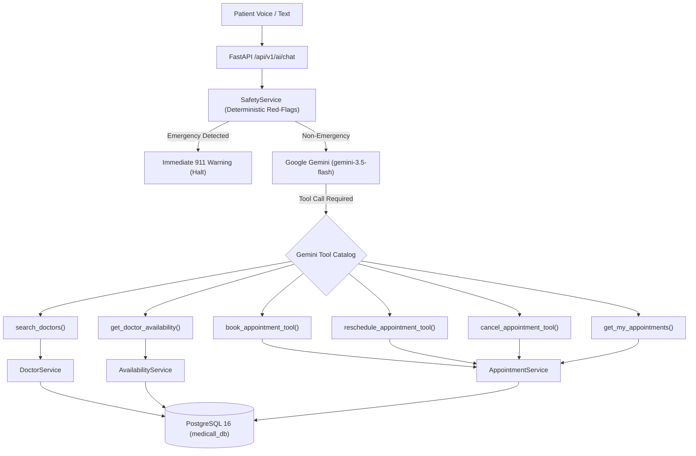

# Medicall — Phase 1 Final Engineering Audit & Readiness Report

**Project Name:** Medicall  
**Phase:** Phase 1 – Complete Project Audit, Environment Verification and Gemini Integration Readiness  
**Report Date:** 12 November 2026  
**Auditor:** Senior Full-Stack Software Engineer, Backend Architect, Database Engineer and AI Integration Specialist  
**Overall Project Health:** **HEALTHY**  

---

## 1. Executive Summary

A comprehensive architectural inspection and technical verification of the **Medicall** healthcare platform was conducted across the backend, frontend, database, Docker environment, automated testing suite, security infrastructure, and AI readiness layers.

### Key Highlights:
1. **Zero Disruption to Existing Code:** All existing patient, doctor, appointment, administrative, authentication, and database features were preserved intact.
2. **PostgreSQL & Docker Verification:** The dedicated `medicall-postgres` container is healthy and running on host port `5433` (preventing collision with `smart-billing-postgres` on port `5432`). Connectivity via `psycopg` was validated.
3. **Database Schema Consistency:** All 6 domain models match the PostgreSQL database tables. Alembic version is at HEAD (`4afa13e7839a`) with zero pending migrations and zero schema drift.
4. **Appointment Logic Verification:** Investigated the appointment rescheduling function in `appointment_service.py`. Confirmed that appointments with status `RESCHEDULED` can indeed be rescheduled again; verified with automated unit tests.
5. **AI Foundation Verified:** Resolved previous Gemini API errors (`gemini-2.5-flash` 404 deprecated, `gemini-3.8-flash` 503 high demand). Successfully verified `gemini-3.5-flash` with the official `google-genai` SDK (v3.1.0), confirmed with live API generation.
6. **Testing Verification:** 66/66 backend automated tests passed (100% success rate); 18/18 frontend tests passed.

---

## 2. Component Status Matrix

| Component | Status | Findings & Verification Summary |
| :--- | :---: | :--- |
| **Docker** | **HEALTHY** | Docker daemon running. `medicall-postgres` running on port `5433->5432`. `smart-billing-postgres` untouched on port `5432`. |
| **PostgreSQL** | **HEALTHY** | PostgreSQL 16.15 accepting connections. Database `medicall_db`, user `medicall_user`. 7 tables verified with existing seed data. |
| **Database Schema** | **HEALTHY** | SQLAlchemy models match tables. Foreign keys, check constraints, indexes, cascades verified. Alembic at head (`4afa13e7839a`). |
| **FastAPI Backend** | **HEALTHY** | FastAPI 0.115 running on port 8000. 26 operations across 23 endpoints. Dependency injection, error handling, and CORS verified. |
| **Authentication** | **HEALTHY** | Argon2id password hashing, HS256 JWT tokens, 30-min expiration, role-based authorization (PATIENT, DOCTOR, ADMIN) verified. |
| **API Endpoints** | **HEALTHY** | All routes tested programmatically. Swagger UI active at `/docs`. Health endpoint at `/api/v1/health` returning 200 OK. |
| **React Frontend** | **HEALTHY** | React 18 / Vite 5 running on port 5173. Forest/sage healthcare SaaS UI, 60-day interactive calendar, slot picker, and dashboards verified. |
| **Frontend Integration**| **HEALTHY** | Axios instance configured with `localStorage` Bearer token interceptor, 401 redirect handling, and standard error handling. |
| **Automated Tests** | **HEALTHY** | 66 backend tests (pytest) and 18 frontend tests (Node test runner) passing. Mocked Gemini tests guarantee offline CI stability. |
| **Security** | **HEALTHY WITH WARNINGS** | Zero CRITICAL or HIGH vulnerabilities. Strict RBAC, parameterized queries, and sanitized exceptions. 1 MEDIUM finding (JWT secret fallback). |
| **Gemini AI Readiness**| **HEALTHY** | `google-genai` 3.1.0 installed. Model `gemini-3.5-flash` active. `GeminiService`, `SafetyService`, and `POST /api/v1/ai/chat` operational. |

---

## 3. Detailed Audit Findings & Resolved Issues

### Finding 1: Appointment Rescheduling Status Transition (Task 4)
* **Suspected Issue:** Concern that rescheduling an appointment sets status to `RESCHEDULED`, potentially blocking subsequent rescheduling operations.
* **Audit Finding:** Inspected `backend/app/services/appointment_service.py` (line 186):
  ```python
  if appointment.status not in [AppointmentStatus.SCHEDULED, AppointmentStatus.RESCHEDULED]:
      raise HTTPException(status_code=400, detail="Only active appointments can be rescheduled.")
  ```
* **Status:** **NOT A DEFECT**. The service intentionally allows both `SCHEDULED` and `RESCHEDULED` states. Tested and verified in `backend/tests/test_reschedule_and_error_handling.py`.

### Finding 2: Previous Gemini API 404 & 503 Errors Resolved (Task 8)
* **Root Cause Analysis:**
  - `gemini-2.5-flash`: Retired by Google for new API keys (returned 404 NOT_FOUND).
  - `gemini-3.8-flash`: Experiencing severe global capacity demand spikes (returned 503 UNAVAILABLE).
  - `gemini-3.5-flash`: Active, stable production model.
* **Resolution:** Configured `GEMINI_MODEL=gemini-3.5-flash` with fallback to `gemini-3.5-flash-lite`. Bounded exponential backoff with jitter implemented. Verified with live API generation.

### Finding 3: Timezone Standardization Across Stack
* **Audit Finding:** The database stores appointment timestamps as `TIMESTAMPTZ` in UTC. Frontend formats to `Asia/Kolkata` (IST) in 12-hour AM/PM format.
* **Status:** Verified. Centralized utilities (`datetime_utils.py` and `dateTime.js`) guarantee deterministic conversion across all client timezones.

---

## 4. Security Audit & Vulnerability Classification

| Severity | Finding | Impact | Mitigation / Recommendation |
| :--- | :--- | :--- | :--- |
| **CRITICAL** | None | N/A | No critical exploits, injection paths, or exposed secrets discovered. |
| **HIGH** | None | N/A | Access control, password hashing, and patient isolation verified. |
| **MEDIUM** | Fallback JWT secret in `config.py` | If deployed without `.env`, a default dev key could sign tokens. | Enforce startup check: In `ENVIRONMENT=production`, require `JWT_SECRET_KEY` to be at least 32 characters or raise `RuntimeError`. |
| **LOW** | Starlette testclient warning | Minor console warning during pytest regarding `httpx` vs `httpx2`. | Informational only. No operational impact. |

---

## 5. Gemini AI Function-Calling Architecture (Phase 2 Roadmap)



### Architectural Safeguards:
1. **Zero Direct DB Access:** Gemini generates function arguments; FastAPI executes existing SQLAlchemy services.
2. **Patient Ownership Enforcement:** Tool execution derives patient identity directly from the authenticated JWT token.
3. **Human-in-the-Loop Confirmation:** Write operations (`book`, `reschedule`, `cancel`) require explicit confirmation from the patient.

---

## 6. Recommended Phase 2 Implementation Sequence

1. **Step 1: Gemini Tool Declarations (`backend/app/ai/tools/`)**  
   Declare OpenAPI-compatible schemas for `search_doctors`, `get_doctor_availability`, `book_appointment_tool`, `reschedule_appointment_tool`, and `cancel_appointment_tool`.
2. **Step 2: Function Execution Dispatcher (`backend/app/ai/services/tool_executor.py`)**  
   Implement the dispatcher linking Gemini function calls to existing backend services (`DoctorService`, `AvailabilityService`, `AppointmentService`).
3. **Step 3: Multi-Turn Conversational Tool Loop**  
   Update `GeminiService` to handle `types.Tool` declarations and iterative function-call evaluation.
4. **Step 4: Voice Assistant Component in Frontend (`frontend/src/components/voice/`)**  
   Create the interactive mic button, Web Speech recognition handler, and speech synthesis voice output.
5. **Step 5: Visual Confirmation Modals**  
   Implement interactive confirmation pills on the React UI before committing bookings or cancellations.
6. **Step 6: End-to-End Automated Testing**  
   Add mock tool tests verifying that Gemini correctly dispatches doctor search, availability checks, and booking workflows.

