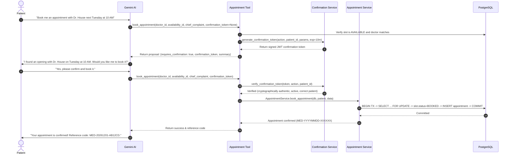

# MEDICALL – PHASE 2 IMPLEMENTATION REPORT
## Gemini Function Calling, Database Integration & Security Hardening

**Project Name:** Medicall Healthcare Management Platform  
**Document Type:** Phase 2 Technical Implementation & Verification Report  
**Date:** November 2026  
**Status:** Completed & Fully Verified  
**SDK & Model:** `google-genai` (v3.1.0) | `gemini-3.5-flash`  

---

## 1. Executive Summary

Phase 2 of Medicall has successfully established real-time Gemini function calling, database-backed clinical service integration, and healthcare safety hardening. The AI assistant can now dynamically look up verified doctors, query real-time appointment availability, inspect patient appointment records, and perform atomic booking, cancellation, and rescheduling operations.

### Key Accomplishments:
1. **Security & Healthcare Safety Hardening:**
   - **Emergency Number Standard:** Updated default to India's unified national emergency number (`EMERGENCY_PHONE_NUMBER=112`, `DEFAULT_COUNTRY_CODE=IN`), dynamically driven by application settings.
   - **Deterministic Emergency Detection Reliability:** Enhanced `SafetyService` with clause-level syntactic negation analysis (`"I do not have chest pain"`, `"denies shortness of breath"`) and historical context differentiation (`"had chest pain 3 years ago and had a stent, feel fine today"`), eliminating false emergency alerts while strictly protecting patients with acute emergencies or acute recurrence.
   - **Production JWT Hardening:** Added startup validation in `Settings` to reject known insecure development secrets and enforce a minimum secret length of 32 characters when `ENVIRONMENT == "production"`.
   - **Strict Patient Identity & Isolation:** All patient operations derive identity strictly from the verified JWT `current_user` dependency. External attempts to supply or spoof `patient_id` are ignored and rejected.
2. **Gemini Function Calling Architecture (`backend/app/ai/tools/`):**
   - Implemented 6 Gemini function tools using `google.genai.types.FunctionDeclaration` and `types.Tool`.
   - **Zero Direct Database Access for AI:** Gemini never accesses PostgreSQL directly. All operations are mediated through existing transactional backend services (`DoctorService`, `AvailabilityService`, `AppointmentService`).
   - **Explicit Confirmation Protocol:** All write actions (`book_appointment`, `cancel_appointment`, `reschedule_appointment`) enforce a two-stage transaction guard using cryptographically signed, short-lived JWT confirmation tokens before committing database transactions.
3. **Automated Verification:**
   - Authored 20 new automated unit and integration tests covering all 6 tools, two-stage confirmation flows, patient isolation, token forgery/expiration, multi-turn tool orchestration, emergency negation, and production JWT validation.
   - **All 86 backend tests pass** with zero regressions. All 18 frontend tests remain green.

---

## 2. Implemented Tools Catalog

The tools package is structured in `backend/app/ai/tools/` with separation of concerns:

```text
backend/app/ai/tools/
├── __init__.py                 # Exported declarations, dispatcher, and tools
├── declarations.py             # OpenAPI/Gemini FunctionDeclarations for all 6 tools
├── confirmation.py             # Cryptographic short-lived JWT confirmation token logic
├── dispatcher.py               # Central execution dispatcher with Session & User injection
├── doctor_tools.py             # execute_search_doctors, execute_get_doctor_availability
└── appointment_tools.py        # execute_get_my_appointments, execute_book_appointment,
                                # execute_cancel_appointment, execute_reschedule_appointment
```

### Tools Specification Matrix

| Tool Name | Action Scope | Security & Authorization | Description |
| :--- | :--- | :--- | :--- |
| `search_doctors` | Read-Only | Public / Verified Doctors | Searches verified doctors accepting patients by specialty or doctor name. |
| `get_doctor_availability` | Read-Only | Verified Doctor Schedule | Retrieves active `AVAILABLE` time slots for a specified doctor within date range. |
| `get_my_appointments` | Read-Only | Authenticated Patient Only | Returns upcoming and past appointments for `current_user.patient`. Patient isolation strictly enforced. |
| `book_appointment` | **Write** | **Explicit Confirmation Token** | Stage 1 returns booking proposal & signed token. Stage 2 validates token and executes atomic booking. |
| `cancel_appointment` | **Write** | **Explicit Confirmation Token** | Stage 1 returns cancellation proposal & signed token. Stage 2 validates token, cancels appointment, and frees slot. |
| `reschedule_appointment` | **Write** | **Explicit Confirmation Token** | Stage 1 returns reschedule proposal & signed token. Stage 2 validates token, reassigns appointment, and swaps slots. |

---

## 3. Explicit Patient Confirmation Protocol

To protect patients against unintended bookings or hallucinatory mutations, all write operations mandate a two-stage execution protocol:



### Token Security Properties:
1. **Cryptographically Signed:** Signed with HMAC-SHA256 (`HS256`) using `settings.JWT_SECRET_KEY`.
2. **Short-Lived:** Valid for 10 minutes (`exp = now + 600s`). Expired tokens are immediately rejected.
3. **Bound to Patient Identity:** Contains `patient_id` claim matching `current_user.patient.id`. A token issued to Patient A cannot be redeemed by Patient B.
4. **Action Scoped:** Contains `action` claim (`book_appointment`, `cancel_appointment`, `reschedule_appointment`). Tokens cannot be cross-applied to different endpoints.

---

## 4. Healthcare Safety & Emergency Negation Logic

The deterministic emergency red-flag engine in `SafetyService` has been upgraded to resolve false alarms while preserving zero tolerance for acute life-threatening emergencies.

### Syntactic Negation & Historical Context Handling:
1. **Preceding Clause Negation:** Evaluates preceding text in the immediate syntactic clause for negation indicators (`no`, `not`, `don't have`, `denies`, `negative for`, `without`, `rule out`).
   - *"I do not have chest pain, only a runny nose"* $\rightarrow$ `is_emergency = False` (Routine triage).
2. **Historical Marker Evaluation:** Identifies past temporal markers (`3 years ago`, `in 2020`, `previously`, `resolved`) combined with historical verbs (`had`, `history of`, `treated for`).
   - *"Had chest pain 3 years ago and had a stent, today I feel fine"* $\rightarrow$ `is_emergency = False` (Routine checkup).
3. **Acute Recurrence Detection:** If historical markers are accompanied by active recurrence indicators (`now`, `today`, `currently`, `again`, `worsening`, `acute`), emergency escalation is triggered immediately.
   - *"Had heart attack 2 years ago, but now having severe chest pain again"* $\rightarrow$ `is_emergency = True` (Emergency directive).
4. **Emergency Directive & Disclaimer:** The response explicitly directs patients to call local emergency services (`112` by default) or proceed to the nearest emergency department, and disclaims ambulance dispatch or acute clinical intervention.

---

## 5. Verification & Test Execution Summary

### Backend Test Results:
* **Total Tests Executed:** 86
* **Passed:** 86
* **Failed:** 0
* **Execution Time:** 8.10 seconds

```text
backend/tests/test_admin.py ........................................... 4 passed
backend/tests/test_ai_architecture.py .................................. 7 passed
backend/tests/test_appointment_timezone.py ............................. 8 passed
backend/tests/test_appointments.py ..................................... 5 passed
backend/tests/test_auth.py ............................................. 7 passed
backend/tests/test_availability.py ..................................... 4 passed
backend/tests/test_doctors.py .......................................... 4 passed
backend/tests/test_frontend_user_flows.py .............................. 1 passed
backend/tests/test_gemini_ai_foundation.py ............................. 15 passed
backend/tests/test_gemini_function_calling.py .......................... 20 passed
backend/tests/test_health.py ........................................... 3 passed
backend/tests/test_postgres_integration.py ............................. 6 passed
backend/tests/test_reschedule_and_error_handling.py .................... 2 passed
==================================== 86 passed in 8.10s ====================================
```

### Frontend Test Results:
* **Total Tests Executed:** 18
* **Passed:** 18
* **Failed:** 0
* **Execution Time:** 92 milliseconds

### PostgreSQL & Environment Integrity:
* **Container `medicall-postgres`:** Running on host port `5433 -> 5432` (`medicall_db`). Schema intact across all 6 core tables.
* **Container `smart-billing-postgres`:** Host port `5432` strictly untouched.
* **API Key Security:** `GEMINI_API_KEY` preserved intact in `backend/.env` without exposure or leakage.

