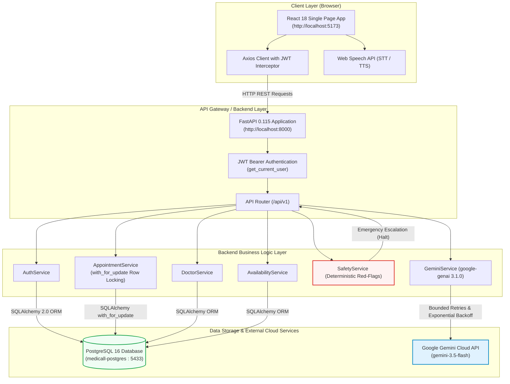

# Medicall — Complete Project Audit & Architectural Analysis

**Document Version:** 1.0.0  
**Audit Date:** 12 November 2026  
**Status:** Phase 1 Project Baseline Verification  
**Auditor:** Senior Full-Stack Software Engineer & AI Integration Specialist  

---

## 1. Executive Project Overview

**Medicall** is a modern digital healthcare appointment management and clinical assistance platform. Designed around a decoupled monorepo architecture, the platform enables patient self-scheduling, practitioner availability publishing, administrative licensing controls, and safe preliminary clinical symptom triage.

The long-term roadmap incorporates a voice-first conversational AI assistant powered by Google Gemini, designed to provide hands-free healthcare navigation, doctor discovery, appointment management, and deterministic medical safety triage while strictly preserving clinical and database safety boundaries.

---

## 2. Monorepo Directory Structure

The project repository is partitioned into two independent applications sharing domain specifications in `docs/`:

```text
medicall/
├── backend/                        # Independent Python 3.11+ / FastAPI application
│   ├── alembic/                    # Database migration environment
│   │   ├── env.py
│   │   └── versions/
│   │       └── 4afa13e7839a_initial_schema_users_patients_doctors_.py
│   ├── app/
│   │   ├── ai/                     # AI Clinical Assistant & Gemini service module
│   │   │   ├── prompts/            # Healthcare prompts & system instructions
│   │   │   │   ├── __init__.py
│   │   │   │   └── healthcare_assistant.py
│   │   │   ├── services/           # Gemini client & deterministic safety services
│   │   │   │   ├── __init__.py
│   │   │   │   ├── gemini_service.py
│   │   │   │   └── safety_service.py
│   │   │   ├── __init__.py
│   │   │   ├── ai_service.py       # Triage & doctor matching business logic
│   │   │   ├── llm_provider.py     # BaseLLMProvider & GeminiLLMProvider abstraction
│   │   │   ├── prompt_manager.py   # Specialized clinical prompt formatting
│   │   │   ├── router.py           # FastAPI routes: POST /ai/chat, GET /ai/status
│   │   │   ├── safety_guardrails.py# Emergency red-flag pattern matchers
│   │   │   └── schemas.py          # Pydantic v2 AI schemas
│   │   ├── api/
│   │   │   └── v1/
│   │   │       ├── endpoints/
│   │   │       │   ├── admin.py    # Doctor license verification endpoints
│   │   │       │   ├── appointments.py # Booking, cancellation, rescheduling
│   │   │       │   ├── auth.py     # Registration, login, profile retrieval
│   │   │       │   ├── availability.py # Slot listing, creation, generation
│   │   │       │   ├── doctors.py  # Doctor directory, profile, recurring schedule
│   │   │       │   └── patients.py # Patient profile & AI consent tracking
│   │   │       └── router.py       # Central v1 APIRouter mounting all endpoints
│   │   ├── core/
│   │   │   ├── config.py           # Pydantic Settings & environment variables
│   │   │   ├── datetime_utils.py   # Asia/Kolkata <-> UTC datetime standardization
│   │   │   ├── dependencies.py     # JWT get_current_user & DB session injection
│   │   │   └── security.py         # Argon2id password hashing & PyJWT token handling
│   │   ├── db/
│   │   │   ├── base.py             # Declarative SQLAlchemy Base
│   │   │   └── session.py          # Engine & SessionLocal factory
│   │   ├── models/                 # SQLAlchemy 2.0 ORM models
│   │   │   ├── __init__.py
│   │   │   ├── appointment.py
│   │   │   ├── availability.py
│   │   │   ├── doctor.py
│   │   │   ├── doctor_schedule.py
│   │   │   ├── patient.py
│   │   │   └── user.py
│   │   ├── schemas/                # Domain Pydantic request/response schemas
│   │   │   ├── appointment.py
│   │   │   ├── auth.py
│   │   │   ├── availability.py
│   │   │   ├── doctor.py
│   │   │   ├── doctor_schedule.py
│   │   │   ├── patient.py
│   │   │   └── user.py
│   │   ├── services/               # Transactional business logic layer
│   │   │   ├── appointment_service.py # Row-locking, concurrency & booking
│   │   │   ├── auth_service.py     # User creation, authentication, role assignment
│   │   │   ├── availability_service.py # Slot generation & recurring schedules
│   │   │   ├── doctor_service.py   # Practitioner directory & scheduling
│   │   │   └── patient_service.py  # Patient demographics & informed consent
│   │   └── main.py                 # FastAPI app entry point & CORS configuration
│   ├── tests/                      # Automated test suite (66 tests)
│   │   ├── conftest.py             # Shared fixtures (in-memory SQLite, test client)
│   │   ├── test_admin.py
│   │   ├── test_ai_architecture.py
│   │   ├── test_appointment_timezone.py
│   │   ├── test_appointments.py
│   │   ├── test_auth.py
│   │   ├── test_availability.py
│   │   ├── test_doctors.py
│   │   ├── test_frontend_user_flows.py
│   │   ├── test_gemini_ai_foundation.py
│   │   ├── test_health.py
│   │   ├── test_postgres_integration.py
│   │   └── test_reschedule_and_error_handling.py
│   ├── venv/                       # Dedicated Python 3.11 virtual environment
│   ├── .env                        # Local runtime secrets (untracked)
│   ├── .env.example                # Safe environment template
│   ├── alembic.ini                 # Migration tool configuration
│   └── requirements.txt            # Locked backend package dependencies
├── frontend/                       # Independent React 18 / Vite 5 application
│   ├── src/
│   │   ├── components/             # Reusable UI widgets
│   │   │   ├── appointment/        # Calendar, 12-hr slot picker, reschedule modal
│   │   │   ├── common/             # Navbar, Footer, ErrorBoundary, ProtectedRoute
│   │   │   └── doctor/             # Practitioner profile cards & specialty badges
│   │   ├── context/                # Global React context (AuthContext)
│   │   ├── hooks/                  # Custom hooks (useAuth)
│   │   ├── layouts/                # MainLayout wrapper
│   │   ├── pages/                  # Route view components
│   │   ├── routes/                 # ProtectedRoute guards (Role-based access)
│   │   ├── services/               # Axios API client & domain service wrappers
│   │   ├── styles/                 # CSS design system (Forest/Sage theme)
│   │   ├── utils/                  # dateTime formatting & error handling utils
│   │   ├── App.jsx                 # Client-side router declarations
│   │   └── main.jsx                # React DOM root hydration
│   ├── package.json                # Frontend package dependencies & test scripts
│   ├── vite.config.js              # Vite bundling configuration
│   └── index.html                  # HTML5 entry template
└── docs/                           # Architectural, operational & API specifications
```

---

## 3. Discovered Technologies & Verified Versions

| Domain | Technology | Version | Purpose & Health |
| :--- | :--- | :--- | :--- |
| **Backend Runtime** | Python | 3.11.9 | Stable runtime environment (`backend/venv`) |
| **Web Framework** | FastAPI | 0.115.6 | Async RESTful API architecture with OpenAPI support |
| **ASGI Server** | Uvicorn | 0.34.0 | High-performance ASGI server with auto-reload |
| **ORM** | SQLAlchemy | 2.0.38 | Declarative mapping with Row-level locking support |
| **Database Driver** | Psycopg (v3) | 3.2.4 | Modern native PostgreSQL async/sync driver |
| **Database Migrations**| Alembic | 1.14.1 | Schema versioning at head (`4afa13e7839a`) |
| **Data Validation** | Pydantic | 2.10.6 | Strict runtime schema enforcement & JSON serialization |
| **Password Hashing** | Argon2-cffi | 23.1.0 | Memory-hard Argon2id cryptographic password hashing |
| **Token Auth** | PyJWT | 2.10.1 | HS256 JWT signature creation and payload validation |
| **AI Integration** | `google-genai` | 3.1.0 | Official Google GenAI SDK for Gemini models |
| **Database Engine** | PostgreSQL | 16.15 | Containerized in Docker (`medicall-postgres`) on port 5433 |
| **Frontend Framework**| React | 18.3.1 | Declarative component UI library |
| **Frontend Tooling** | Vite | 5.4.14 | Fast ES module development server and rollup packager |
| **Client Routing** | React Router | 6.28.2 | Declarative client-side routing with nested layouts |
| **HTTP Client** | Axios | 1.7.9 | Request/response interceptors with automatic Bearer tokens |
| **Iconography** | Lucide React | 0.475.0 | Comprehensive clean medical and navigation icons |

---

## 4. End-to-End System Communication Flow



---

## 5. Completed vs. Missing Components

### Completed & Operational
- **User Authentication & Authorization:** Multi-role user creation (PATIENT, DOCTOR, ADMIN), Argon2 password hashing, JWT creation/validation, and RBAC endpoint protection.
- **Doctor Directory & Verification:** Public listing, specialty filtering, doctor self-scheduling, and admin approval workflows (`PATCH /admin/doctors/{id}/verify`).
- **Availability Management:** Discrete slot creation, slot auto-generation from weekly recurring schedule templates, slot collision protection, and slot filtering.
- **Appointment Lifecycle:** Atomic booking with row-level locks (`with_for_update()`), cancellation with slot restoration, multi-turn rescheduling, and timezone normalization (Asia/Kolkata <-> UTC).
- **Frontend Healthcare UI:** Modern forest/sage design system, interactive 60-day calendar, 12-hour AM/PM time slot picker, patient appointments dashboard, doctor consultation manager, and admin verification dashboard.
- **Deterministic Healthcare Safety:** Regex-driven acute red-flag detection (cardiac, stroke, respiratory, hemorrhage, anaphylaxis, crisis) that executes before any AI inference.
- **Gemini AI Foundation:** Configured with `gemini-3.5-flash` using official `google-genai` SDK with bounded exponential backoff on 503/429 and automatic fallback to `gemini-3.5-flash-lite`.

### Missing / Phase 2 Roadmap
- **Gemini Controlled Function Calling:** Connecting the conversational AI model to backend query functions (`search_doctors`, `get_availability`, `book_appointment_tool`) using official Gemini tool declarations.
- **Browser-Native Voice Assistant UI:** Microphone visualizer, Web Speech recognition events, and speech synthesis narration of AI responses.
- **Strict Human-in-the-Loop Confirmation:** Requiring explicit confirmation modals before executing write operations (booking, rescheduling, cancelling) triggered by AI speech.

---

## 6. Detailed Investigation: Appointment Rescheduling Logic

In Task 4, a specific potential defect was investigated: whether an appointment in `RESCHEDULED` status can be rescheduled a second time.

### Inspection Finding in `appointment_service.py` (Lines 184–190):
```python
appointment = AppointmentService.get_appointment_by_id(db, appointment_id, current_user)

if appointment.status not in [AppointmentStatus.SCHEDULED, AppointmentStatus.RESCHEDULED]:
    raise HTTPException(
        status_code=status.HTTP_400_BAD_REQUEST,
        detail="Only active appointments (scheduled or rescheduled) can be rescheduled."
    )
```

### Analysis:
1. The service explicitly permits **both** `SCHEDULED` and `RESCHEDULED` statuses.
2. If a patient reschedules an appointment once (changing status from `SCHEDULED` to `RESCHEDULED`), a subsequent reschedule request is **explicitly permitted**.
3. Only finalized/inactive appointments (`COMPLETED`, `CANCELLED_PATIENT`, `CANCELLED_DOCTOR`) are barred from rescheduling.
4. This behavior is actively protected by unit test `test_reschedule_already_rescheduled_appointment_allowed` in `backend/tests/test_reschedule_and_error_handling.py`.
5. **Conclusion:** This is not a defect; it is verified, intentional, and functional business logic allowing flexible outpatient rescheduling.

